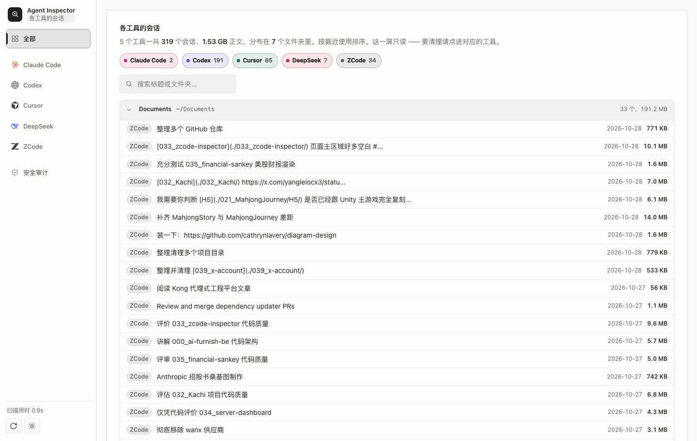

# Agent Inspector

在本机浏览 ZCode、Codex、Claude Code、Cursor 和 DeepSeek Harness 的磁盘占用与历史会话，核对清理后果，再选择要删除的内容；也可以只读地扫一遍会话正文，看凭据有没有外泄过。使用 Node.js 内置模块，无第三方运行依赖。

<p align="center">
  
</p>

<p align="center">
  
</p>

界面分两栏：左侧文件清单按「删了会怎样」分成可直接清理、谨慎清理、请勿删除三档；右侧会话管理按工具与文件夹折叠，逐条会话显示体积和最后使用时间。清理前必须勾选并确认，删除默认移入废纸篓。

## 启动

需要 Node.js ≥ 22.5。macOS 支持全部操作；其他系统支持扫描与文件备份删除，数据库写入还要求可用的 `pgrep` 进程检查。

```bash
git clone https://github.com/cookabc/agent-inspector.git
cd agent-inspector
npm start
```

浏览器自动打开 [本地页面](http://127.0.0.1:4173)。服务只监听 `127.0.0.1`，不提供远程访问。

| 参数 | 默认值 | 用途 |
|---|---|---|
| `--port <n>` | `4173`，也可用 `PORT` | 监听端口；`0` 自动分配空闲端口 |
| `--app <id>` | 全部 | `zcode`、`codex`、`claude`、`cursor`、`dsh` |
| `--root <dir>` | 工具自己的数据目录 | 覆盖所选工具的第一个目标；未指定 `--app` 时使用 ZCode 分类 |
| `--backup-dir <dir>` | 项目下的 `backups/` | 设置清理前备份的保存目录 |
| `--no-open` | 关闭 | 不自动打开浏览器 |
| `--help` / `--version` | — | 显示帮助或版本后退出 |

例如，审计独立的 Codex 数据副本：

```bash
npm start -- --app codex --root /absolute/path/to/codex-copy --no-open
```

`--root` 只替换扫描位置，分类规则仍属于指定工具。它不会把任意目录变成通用清理目标。多目标工具的其他目标仍使用默认路径；测试必须设置临时 `HOME`，并指定独立的 `--backup-dir`。

## 支持范围

| 工具 | 默认扫描位置 | 会话清理方式 |
|---|---|---|
| ZCode | `~/.zcode` | 删除正文库与任务索引中的目标及后代（含 `cli/` 下该会话的子 Agent 记录、产物、贴图、命令日志），随后 VACUUM |
| Codex | `~/.codex` | 删除线程索引、历史投影和日志中的关联行；同线程的 rollout 正文（含分页续段）一并移入废纸篓 |
| Claude Code | `~/.claude`、`~/.claude.json` | 正文是 `projects/` 下的 JSONL 文件；在会话管理里按会话删（备份后移入废纸篓） |
| Cursor | `~/.cursor`、`~/Library/Application Support/Cursor` | 删除会话及仅由该批会话引用的 blob；支持孤儿 transcript 回灌 |
| DeepSeek Harness | `~/.dsh` | 删除整个会话目录（含 lock）与投影缓存；投影缓存同时提供列表元数据 |

工具标签用于查看单个工具；「全部」按项目聚合会话，供查找和浏览，不提供混合删除。「安全审计」扫各工具会话正文里的凭据外泄模式，只读、不给删除入口。

文件分类分为可安全清理、谨慎清理、异常建议清理、请勿删除。凭据、配置和数据库文件受保护。未归类内容不默认推荐；符号链接不可直接选择。

「推荐清理」和「一键清理」只生成选择与确认清单。执行前仍可取消项目。会话清理的默认范围还会跳过近期使用和置顶项，具体范围以界面为准。

## 清理与备份

### 会话清理是级联的

会话是这个工具的主体：列表占满整宽，点开任一条能看到它的全部属性，以及**删掉它到底会带走什么**（「所属内容」）。清理一条会话不是只抹数据库 —— 顺序是：

1. 备份这条会话在磁盘上的全部专属文件；
2. 删数据库行并 VACUUM；
3. 那些文件移入废纸篓（非 macOS 上改为「备份后彻底删除」，结果里会标明走的是哪条）。

各工具的级联范围差别很大，界面上会逐项列出：

| 工具 | 一次会话清理带走什么 |
|---|---|
| ZCode | 两个库的 18 类表行 + `cli/{agents,artifacts,image-cache}/sess_<id>/` + `cli/rollout/model-io-sess_<id>.jsonl` + `cli/exec/sess_<id>/` |
| Codex | 三个库家族里所有带 thread_id 的行 + 同线程的**全部** rollout 段（分页续段一并带走 —— 留一段残骸会让恢复报 missing source rollout） |
| Claude Code | 一个 `.jsonl`（正文即文件，没有行可删） |
| Cursor | `cursorDiskKV` 的会话行 + 独占的内容池 blob + 库外 `agent-transcripts/<id>/`；`conversation-search.db` 里的旧文本由 Cursor 自己维护，本工具不写它 |
| DeepSeek Harness | 整个 `session-<id>/` 目录（含 lock）+ 投影 JSON；`workspace.json` 里的悬空 id 会在下次启动时重建 |

**备份 → 删库 → 删文件**这个顺序是刻意的：反过来的话，一旦备份失败就会出现「会话从列表消失、文件一个没少」，而文件恰恰是以前完全没被清掉的那一半。备份没做完时整批中止，数据库一行不动。

### 文件

- **移入废纸篓**：macOS 下移到 `~/.Trash`；跨文件系统移动失败时会保留源文件并报告失败。
- **彻底删除**：先复制并核对内容，再删除原路径。每项使用独立备份目录，按工具、目标和相对路径存放；空文件也可以备份。备份失败时不删除该项。
- 路径必须位于目标根内，不能使用绝对路径、`..` 或符号链接跳转。删除目录前递归检查受保护内容。
- 整批路径先校验，执行期间逐项报告结果。磁盘错误可能导致部分项成功、部分项失败；已成功项会从当前选择中移除。

文件清单收在页面底部的「磁盘与其他」里，默认折起，标题行给出体积与条目数。收起不等于藏起来 —— 折起后仍然告诉你值不值得展开。

备份也占用磁盘。文件从扫描目录移走，不等于整块磁盘立即增加同样多的可用空间。确认恢复不再需要后，再自行管理备份。

### 数据库

正式清理与回灌要求目标应用完全退出。进程检查失败会阻止写入；只读预览仍可使用。

写入顺序统一为：

1. 校验主库路径及已有 WAL、SHM、journal 侧文件，再打开全部相关库并取得写锁，检查完整性和外键。
2. 将主库与存在的 WAL/SHM/journal 侧文件复制到独立目录，核对文件内容。
3. 在事务中重新核对目标并执行 SQL。
4. 检查所有库，再逐库提交。
5. 清理操作执行 VACUUM，再检查完整性。

SQL 或提交前检查失败时，尚未提交的事务全部回滚。**多个独立 SQLite 文件无法保证断电或提交阶段磁盘故障下的全局原子性。** 提交或 VACUUM 阶段失败时，错误会列明已提交的库和备份位置。停止后续清理，先核对并恢复数据。

一个服务实例同时只接受一项写操作，重叠请求返回 `409`。不要同时启动多个实例操作同一批文件；文件系统操作无法隔离外部程序的并发修改。数据库锁也不能代替退出目标应用的要求。

Codex 根目录同时存在多个 `state_*.sqlite` 时，无法可靠确定当前使用的索引，暂不提供会话清理。文件扫描会合并可读索引中的会话 ID，避免把仍有索引的正文误标为孤儿。

### 恢复备份

先退出目标应用并停止 Inspector。保留故障现场副本，避免恢复过程覆盖唯一证据。

- 文件：使用操作返回的 `backup` 路径，将副本放回原目标与相对路径。
- 数据库：按同一次操作的备份恢复整组相关库。先将当前主库及其 `-wal`、`-shm`、`-journal` 一起移到现场保留目录，再复制备份中的主库及侧文件；不要混用不同批次的文件，也不要留下旧侧文件。
- 恢复后先做只读检查，确认目标应用能正常读取会话，再继续使用。

`backups/` 包含完整会话正文，已被 Git 忽略。自定义备份目录也应保持私有，不应提交到仓库。

## Cursor 回灌边界

回灌面向「transcript 存在、会话头缺失」的会话，只恢复可重建的文本和工具调用摘要。不能重建原始检查点、工具结果 blob 或执行环境。

读不到会话头时不判断孤儿。已有会话头或已有同 ID 正文的会话会跳过；写入采用插入，不覆盖已有正文。回灌需要明确选择、输入确认词、退出 Cursor，并完成备份与数据库检查。

blob 清理使用已识别的文本 hash、二进制 hash 和工具调用 ID 引用关系。未知键族引用到的 blob，以及保留 blob 引用到的后代，均予以保留。Cursor 内部格式不是稳定的公开协议；出现新格式时，应先补夹具和识别规则再扩大清理范围。

## 安全审计

回答一个问题：**凭据有没有从会话里漏出去过**。它读会话正文（只读），把工具调用与输出按落盘顺序过一遍，报三级结果：

| 级别 | 判据 |
|---|---|
| 高危 | 先读到敏感文件（`.env`、`id_rsa`、`credentials.json`…），之后同一条值出现在外发调用里 |
| 疑似 | 外发调用里内嵌凭据样式（AWS key、GitHub token、URL 内嵌账号密码、Bearer 等） |
| 提示 | 读过敏感文件。内容已经进了模型上下文 —— 这不是要删的东西，是该知道的事 |

外发的判据按形态分：shell 看外发动词与外部 URL，Codex 的 `exec` 是 JS 源码，看取网工具与 `fetch` 族，WebFetch / 搜索生来就是外发。本地地址不作为“外部 URL”信号，但 `curl`、`fetch` 等调用仍会按网络操作检查；这不是实际网络流量或发送成功的证明。凭据值的来源只有两种：敏感文件的读取输出，以及 `printenv` / `env` 的倾倒输出。

**证据一律脱敏。** 这是硬约束，不是修饰：这个工具的存在意义是审计凭据泄露，如果它自己把凭据摘出来摆在页面上，它就是新的泄露面。页面上只出现形如 `AKI••••QQ` 的遮蔽值与命中点附近的短窗口，窗口内所有已知值在截取**之前**就替换好；输出前还有一道终检，对 bank 里每个值、每条样式再扫一遍，撞上就地再脱一次。

已知边界：

- Cursor 暂不支持。它的正文散在内容寻址 blob 里，解开整池要十几秒起步 —— 那个代价留给「按会话清理」那条线，那边有明确的动作要配。
- 单条文本只扫前 256 KiB，按 UTF-8 字节计数。超过窗口的内容可能含有凭据，界面会标为扫描不完整。
- JSONL 最多读取前 48 MiB，超过 512 KiB 的行跳过；DSH 解压输出上限为 96 MiB，仅解析前 48 MiB。读取或解压失败会单独报告。
- 单个会话累计超过 32 MiB 或 60 条命中后停止，被截断的会话在界面上标出。
- 模式匹配不是数据流分析。它不认得变量在中间被改写、拼接、编码或分片传输；反过来，把测试用的假 key 写进会话也会照样报。**它减少的是漏看，不是替你做判断。**

## 扫描口径与限制

- 文件清单主要读取文件元数据；Codex 分类会额外读取 rollout 首行，识别分页续段及其引用的原始会话，保护分页依赖。
- 会话列表会读取数据库、投影缓存或正文元数据。Claude 读取文件开头；Cursor 回灌扫描逐行解析 transcript。
- 「安全审计」会读会话正文（其余功能不读）。见上一节的口径与边界。
- DeepSeek 优先使用投影；缺失时尝试内置 zstd 解压，输出上限 96 MiB，解析前 400 行。旧 Node 无 zstd 时保留会话与体积，并说明标题不可用。
- SQLite 请求只读连接，并开启 `query_only`，补足旧 Node 对 `readOnly` 选项的支持差异；直接打开失败时尝试临时副本。SQLite 可能维护 WAL 的共享内存侧文件，不承诺扫描目录完全没有文件系统变化。
- 会话库不可读时不应把所有文件推断成孤儿。错误与不完整结果会在页面显示。
- 文件体积使用 1024 进制；它是逻辑文件大小，不等同于 APFS 实际分配空间、稀疏文件占用或可立即回收空间。
- 文件列表缓存 15 秒，会话列表 60 秒，Cursor 引用分析 10 分钟，安全审计 10 分钟。手动重新扫描可以刷新；清理和回灌结束后相关缓存失效。
- 不同工具升级后可能改变数据库结构或落盘格式。不识别的格式需要维护适配器；不应绕过错误强制清理。

## 开发与验证

```bash
npm test
npm run check
```

`check` 检查源码语法并执行测试，只遍历源码目录，不读取 `backups/`。测试使用临时 HOME、临时数据库和独立备份目录，不清理真实会话数据。

测试覆盖分类、会话契约、路径与跨站边界、备份、写锁、跨库回滚、父子会话、Cursor 引用保留与回灌、凭据外泄判定与脱敏不变量，以及前端纯函数和静态交互约束。静态前端测试不能替代浏览器行为验证。

`npm run test:ui` 使用合成接口数据检查视图切换、刷新、清理入口、弹窗焦点、错误反馈与窄屏，不连接真实会话接口。默认使用 macOS 的 Google Chrome；其他安装位置可通过 `CHROME_PATH` 指定可执行文件。

CI 配置在 Linux、macOS 与 Node 22.5.0 / 22.23.4 / 24.22.1 / 26.12.1 上执行检查。本地通过不等于远程 CI 已通过。Node 22.5 缺少 zstd 测试夹具所需 API，对应用例会跳过。

| 文件 | 职责 |
|---|---|
| `server.mjs` | 本地 HTTP、请求校验、文件操作、缓存与 worker 调度 |
| `lib/apps/` | 工具注册、目标目录、分类与运行进程 |
| `lib/scan.mjs` | 文件清单、分类汇总与孤儿判定 |
| `lib/tasks*.mjs` | 各工具会话适配器与共同返回契约 |
| `lib/cursor-purge.mjs` | Cursor 引用分析与按会话删除 |
| `lib/cursor-recover.mjs` | Cursor transcript 扫描与受控回灌 |
| `lib/audit.mjs` | 凭据外泄判定核心：敏感路径、密文样式、外发判据、脱敏（纯函数） |
| `lib/audit-sessions.mjs` | 各工具会话正文 → 事件流 → 判定 |
| `lib/backup.mjs` | 独立备份目录与复制校验 |
| `lib/database-write.mjs` | 数据库锁、事务、备份、提交和自检 |
| `lib/write-guard.mjs` | 单实例写操作互斥 |
| `lib/validation.mjs` | 会话请求参数校验 |
| `lib/sqlite-open.mjs`、`lib/db-worker.mjs` | 只读连接、临时副本与后台执行 |
| `public/` | 页面、样式、浏览器状态和纯函数 |
| `test/` | 临时数据回归测试 |

维护约定见 [CONTRIBUTING.md](CONTRIBUTING.md)。

## 许可

[MIT](LICENSE)
