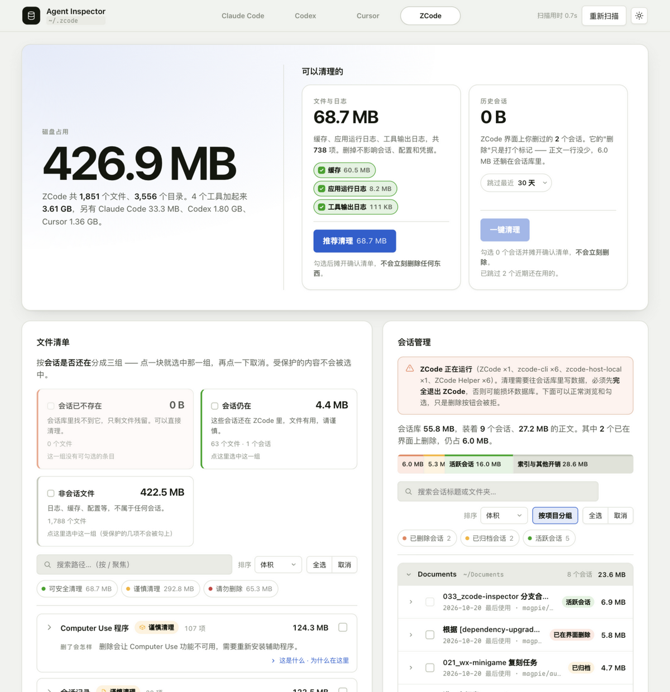

# Agent Inspector

把这台机器上四个 coding agent 的落盘目录摊开看清楚：每一类东西占多少、删了会怎样，然后决定清掉哪些。
两件事一起做 —— **浏览**（这里到底都放了些什么）和**清理**（哪些能删、删了会怎样）。

| 工具 | 扫哪里 | 能清到什么程度 |
|---|---|---|
| ZCode | `~/.zcode` | 文件 + 会话库里的**按任务删除**（事务 + VACUUM，先备份） |
| Codex | `~/.codex` | 文件 + 会话库里的**按线程删除**；正文是磁盘上的 rollout 文件，那部分归文件清单 |
| Claude Code | `~/.claude`、`~/.claude.json` | 文件 —— 它的会话正文本身就是 `.jsonl`，没有库行可删 |
| Cursor | `~/.cursor`、`~/Library/Application Support/Cursor` | **只读分析** + **孤儿会话回灌** —— 不按行删；界面看不到、transcript 还在的会话可以补回去（只新增，不覆盖） |

还额外做一件这些工具自己都没做的事：把界面上**早已删掉、正文却还留在磁盘上**的历史会话清干净。
ZCode 的"删除任务"只是把 `tasks.deleted` 置 1，一行正文都没少。

Cursor 是一个反向的例子：会话列表只认 `state.vscdb` 里的 `composerHeaders`，而正文的
`.jsonl` transcript 在 `~/.cursor/projects/` 下另存一份，两者没有同步机制。配置目录被重建、
迁移失败或清理过后，头没了、正文还在 —— 会话就从界面里消失了。这个工具能把这类**孤儿会话
只新增地回灌**回 `state.vscdb`（见 [Cursor：把界面看不到的会话找回来](#cursor把界面看不到的会话找回来)）。

零依赖，只用 Node 内置模块。文件扫描只读 `stat`，**从不读取文件内容**；
读会话库走的是独立副本上的只读连接。

> 下面出现的具体数字（多少 GB、多少个文件）都是某一台机器上某一刻的实测值，用来举例说明。
> 换一台机器必然不同，页面上显示的才是你这台机器的实时数据。

<p align="center">
  
</p>

## 环境

| | |
|---|---|
| 系统 | **macOS**。"移入废纸篓"用 `~/.Trash`，"在 Finder 中显示"用 `open -R` |
| Node | **≥ 22.5**（`node:sqlite` 从这个版本起才有；22.5–23.3 需要 `--experimental-sqlite`，23.4 起不用）。在 Node 24 上开发与实测 |
| 依赖 | 无。不用 `npm install` |

非 macOS 上也能扫、能看、能彻底删除，但"移入废纸篓"和"在 Finder 中显示"没有落点 ——
服务端启动时会说明，界面里那两条路也会被禁用，不会让你按了才发现。

## 跑起来

```bash
git clone https://github.com/cookabc/zcode-inspector.git
cd zcode-inspector
node server.mjs
```

浏览器会自动打开 <http://127.0.0.1:4173>，四个工具排成页面顶部的一排标签。

| 参数 | 默认 | 说明 |
|---|---|---|
| `--port` | `4173`（或环境变量 `PORT`） | 换端口 |
| `--app` | 全部四个 | 只装某一个工具的分类表，例如 `--app codex` |
| `--root` | 各工具自己的目录 | 换审计目标，接受 `~/...` 或绝对路径；只作用于第一个目标，并且隐含 `--app zcode` |
| `--no-open` | — | 不自动打开浏览器 |

> `--root` 只是换个目录给你看，**分类规则仍然是按那个工具的目录结构写的**（见 `lib/apps/<id>.mjs`）。
> 指到别处不会自动变通用，只会得到一堆"未知内容"——那恰好也是它诚实的表现：看不懂的东西不装作看得懂。

> 如果 `node` 不在 PATH 上（nvm 装的、或从非交互 shell 里跑），写全路径即可 ——
> 形如 `~/.nvm/versions/node/<版本>/bin/node server.mjs`

## 它怎么判断

每个工具一张规则表，在 `lib/apps/` 里各占一个文件（`zcode.mjs`、`codex.mjs`、`claude.mjs`、`cursor.mjs`），
共用 `common.mjs` 里的匹配器。规则自上而下，第一个命中的说了算。
每个分类必须回答四个问题：

| 字段 | 回答什么 |
|---|---|
| `what` | 这是什么（收起在"这是什么"里） |
| `why` | 为什么在这里（同上） |
| `outcome` | **删了会怎样**（常驻显示，决定删不删看的就是它） |
| `verdict` | 归到哪一档 |

`outcome` 要求写具体后果，不许写"可能有影响"：

| 分类 | 删了会怎样 |
|---|---|
| 失控放大日志 | 只丢失那几次命令的原始字节，结论已经写进会话记录 |
| 会话数据库 | 删除 = 历史彻底消失且不可恢复 |
| 凭据 | 全部 provider 掉线，需要重新登录 |
| 会话贴图（ZCode `cli/image-cache/`） | 历史会话里的图片缩略图失效，原件不可再生 |

四档：

- 🟢 **可安全清理** —— 日志、缓存、系统垃圾。删了会自动重建或本来就无关紧要。
- 🟡 **谨慎清理** —— 会话记录、产物、记忆。要么含隐私，要么不可再生，自己权衡。
- 🟠 **异常，建议清理** —— 失控放大的日志、旧版本运行时这类明显没在用的东西。
- 🔴 **请勿删除** —— 数据库、凭据、配置、用量统计。工具直接锁住勾选框。

**规则表刻意不做兜底猜测。** `cli/plugins/` 曾经被一条过宽的规则归进"缓存"，
差点把插件自己的持久数据当缓存推荐删掉。现在读不懂的一律落在 `unknown`，不进默认勾选
（这台机器上四个工具加起来一万七千多个文件，`unknown` 只有 59 个 —— 而且都是
Electron 自建的状态文件（`Cookies`、`shared_proto_db/`、`VideoDecodeStats/`）这类
真正读不懂的东西，不是漏了规则）。

> 这条判据出过一次错，值得记下来：`~/.codex/backups/` 里躺着 44 MB 的项目 zip，
> 一度整批落进 `unknown`。原因是 `backups/` 这条规则只在 Claude 那一份里写了，
> 另三家只有靠后缀匹配的 `.bak` 规则 —— 同一个形态在四张表里漂成了两种答案。
> 现在跨 app 同形的规则收在 `lib/apps/common.mjs` 的 `SHARED_RULES` 里，
> 并有 `test/classification.test.mjs` 盯着「四家对同一条共享规则是否给出同一个答案」。
> 顺带分出了 `dataBackup`（完整数据副本）与 `configBackup`（配置副本）两档：
> 前者里面可能是别人项目的 zip，说成"配置备份"是替它撒谎。

要加一类，在对应工具的规则表里加一条即可 —— 匹配是纯函数，加完刷新页面就能看到。
跨工具同形的规则请放进 `SHARED_RULES`，别每家抄一份。

## 界面

工具选择在页面 header 上：四个 Agent 按名称字母顺序排成一排，每个标签写着它占多少、
装没装（没装的那一个压暗，但仍然可以点进去确认它真的没落盘）。页面里不再有
「全部」这种把四张分类表叠起来的合成视图 —— 各工具把东西存在完全不同的地方，
叠在一起只会骗人。选中谁，整页就只读谁的数据；这个选择记在 localStorage 里。

页面往下依次是：会话管理（最常用的入口，自带滚动区）→ 总览（当前工具的总量与可清理项）
→ 诊断 → 文件清单。会话列表与只读的库构成图都限制在各自的可滚动窗口里，组头吸顶，
不会把整页撑成几千像素。

### 总览与清理

首屏是一张卡：左边当前工具的总字节数，右边能清掉什么，底下一行四个工具加起来的总量。
这两件事本来是一句话的两半（左边是分母，右边是分子），拆成两张卡反而要人自己接起来。

### 可以清理的

两条独立的清理线并排：

| | 文件与日志 | 历史任务 |
|---|---|---|
| 在哪 | 文件树里 | 会话库里（ZCode / Codex），或就是磁盘上的正文文件（Claude Code）；Cursor 只读摊开 |
| 一键操作 | 推荐清理 | 一键清理 |
| 怎么删 | 移入废纸篓 / 彻底删除 | 事务删除 + VACUUM（先自动备份） |

**一键操作都只勾选和摊开确认清单，不执行删除。** 按下去之后你可以把不想要的取消掉，再决定。

「推荐清理」旁边逐项列出它包含哪些分类，每一项可以单独开关，按钮上的数字当场跟着变。
勾选范围按工具分别记住，切回去还是你上次调成的样子。
「一键清理」默认跳过近期还在用的任务（默认 30 天）—— 那是"已删除"但你可能还想回头翻的旧对话。
Cursor 没有这一条：它对会话库只读，页面直接把库的构成摊开，而不是给一个按不动的按钮。
不过它有一个独立的**回灌**入口（见下），方向相反 —— 不是删，而是把丢失的会话补回来。

### 文件清单

工具栏：**搜索 → 筛选按钮 → 排序 → 全选 / 取消**（任务面板同一套节奏）。

「会话与非会话」按**会话是否还在会话库里**把文件劈成三块：会话已不存在（孤儿）、会话仍在、
非会话文件。它跟清单是同一件事的两面，所以放在同一个面板里。判据来自每个工具自己的
`liveSessions()` —— 读不到库时**放弃判定**，而不是把所有会话文件标成可清理。

三块**互斥** —— 它们是把全部文件劈成三份，一组就是一组，不是三个独立的勾。点一块是"换成这一组"：

| 块上的状态 | 点下去会怎样 |
|---|---|
| 一个没勾 | 选中这一组 |
| 勾满 | 取消 |
| 勾了一半 | 补全（框里填色浅一档，`aria-checked="mixed"`）|

受保护的内容不进勾选（跟「全选」同一条规矩），所以「非会话文件」那块勾满时是它自己文件数**减去**
凭据、会话库、配置、用量那几项 —— 块上会写明"受保护的几项不会被勾上"，不假装全选上了。

卡片头上的计数、已选数、右上角的体积，算的都是**当前看得见的那些行**（筛过之后写"筛出 35 / 1,993 项"、
"2.7 MB / 2.84 GB"，斜杠后面是整类有多大）。一个文件都不剩的分类会整张消失，不留空壳。

斜杠后面那一段**只在两个数真的不一样时才出现**。`fmtBytes` 在 GB 量级只留两位小数，
所以"筛出 1,958 / 1,993 项"那次，藏起来的 2.7 MB 根本翻不动 2.84 GB 的最后一位，
两个数会印成一样的 —— 那种时候就不印第二遍，免得写出"2.84 GB / 2.84 GB"这种看着像坏掉的东西。

**体积一律 1024 进制**（1 GB = 1024 MB = 1,073,741,824 字节）。这一点值得写下来，
因为它正好是"我自己加了一遍，对不上"的常见来源：把 611.7 MB 除以 1000 当成 0.61 GB，
再和 2.84 GB 相加得 3.45，而页面上写 3.44 —— 其实 611.7 MB = 0.597 GB，2.84 + 0.597 = 3.437。
屏幕上每个体积都可以悬停看**精确字节数**，不用心算也不必信四舍五入。

三块会话分组是全部文件的完整划分，所以**三块体积之和恒等于首屏总量**（字节级相等，不是约等于）；
筛选到某一组时，剩下的分类卡片加起来也恒等于那一块。

分类卡片**常驻只留"删了会怎样"这一句**，"这是什么 / 为什么在这里"收进展开开关。

### 会话管理

每个工具的会话存在哪、能清到什么程度，都不一样，面板按能力分三种走法：

- **ZCode** —— 正文在 `cli/db/db.sqlite`，元数据在 `v2/tasks-index.sqlite`，
  两边靠 `task_id === session.id` 关联。按任务删除：库里连带删掉会话、消息、附件块、用量行，然后 VACUUM。
- **Codex** —— 三个库按 thread id 串起来：`state_5.sqlite`（界面主列表）、
  `thread_history_*.sqlite`（投影后的逐轮条目）、`logs_2.sqlite`（结构化日志）。
  按线程删除会一起清这三家；但**正文是 `sessions/**/rollout-*.jsonl` 文件本身，不在库里**，
  行删完那些文件会变成残骸，归「文件清单」那条线。索引里已经没有行的残骸，勾选后直接走文件清理。
- **Claude Code** —— 正文就是 `projects/` 下的 `.jsonl` 文件，没有库行可删。
  这里勾选后交给文件清理：默认进废纸篓，可随时恢复。
- **Cursor** —— 正文以键值对存在 `state.vscdb`，由 IDE 独占写入，键之间没有外键可依。
  只读：按键族（内容寻址 blob、对话气泡、检查点…）把 364.8 MB 的库摊开给你数清楚，不给勾选。

面板做的事：

- **库构成图**：一根等比柱切开这块存储 —— 已删除 / 已归档 / 活跃 / 界面不可见 / 索引与其他开销。
  名称和体积直接写在色块里，块宽就是占比，不另设图例行。筛选按钮上说的是"几个任务"，
  跟色块上的体积互补，不重复。Codex 的分母要把库和磁盘正文加起来，否则色块会画到 300% 宽。
- **会话列表**：默认按项目分组（组头是文件夹名、完整路径、会话数、合计体积），
  组内一行一个会话：标题、最后使用时间、模型、子会话数、正文体积。可搜索、排序、切换成平铺。
  点行首的三角展开详情 —— 创建/最后使用时间、完整文件夹、会话 ID、模型、正文位置，
  提供「复制会话 ID」和「在文件清单中定位」。整行仍然是勾选，三角单独负责展开。
- **空跑核对**：不放心就先跑一次只读预览，它会把**实际会删掉的行数**逐库逐表列出来。
  这一步不开事务、不加任何写锁，**应用开着跑也绝对安全**。

### Cursor：把界面看不到的会话找回来

Cursor 有两份存储，彼此不同步：

| | 在哪 | 作用 |
|---|---|---|
| 会话头 | `state.vscdb` 的 `composerHeaders` | 界面会话列表**只认这里**；没有行就不显示 |
| 正文 | `~/.cursor/projects/<workspace>/agent-transcripts/<id>/<id>.jsonl` | Agent 实际写下的逐轮记录 |

所以"界面上看不到"有两种完全不同的情况：正文被删了（真的没了），或**头没了、正文还在**（孤儿）。
任务面板为 Cursor 多渲染一块「界面里看不到的会话」，把后者列出来：标题、工作区、日期、
消息数、工具调用次数、文件体积。扫描只读，且只读副本。

选中后按「回灌到 Cursor…」，会写回三组行，结构与 Cursor 自己生成的一致：

- `composerHeaders` —— 一条会话头（标题、时间、工作区）
- `cursorDiskKV` 的 `composerData:<id>` —— 会话元数据与气泡索引
- `cursorDiskKV` 的 `bubbleId:<id>:<bid>` —— 每条用户/助手消息一个气泡

写之前有四道闸：

1. **Cursor 必须完全退出**（`pgrep` 探测 `Cursor` / `cursor-agent` / `cursor-mcp` / Helper）。
   库由 IDE 独占写入，开着写会抢锁甚至损坏数据。空跑不受这条限制。
2. **先整库备份**到 `backups/<时间戳>-cursor-recover/`（连同 `-wal` / `-shm`）。
3. **事务内完成**：`BEGIN IMMEDIATE` → 三组 `INSERT` → `COMMIT`，失败整体回滚。
4. **写完自检**：`PRAGMA quick_check` 的结果如实返回，并 `wal_checkpoint(TRUNCATE)` 收尾。

回灌**只新增、不覆盖**：每一条都先查 `composerHeaders`，已存在的会话直接跳过；
所以对同一批会话重复执行是幂等的，不会产生重复气泡，也不会改动任何现有会话。

它恢复的是**文本正文与工具调用的一行引用**。检查点（`checkpointId`，文件快照）、
内容寻址 blob（`agentKv`，工具结果原文）和改动前的文件状态没有可重建的来源，
不伪造 —— 所以恢复后会话能读、能搜、能继续，但那几次对话里的"回退到某一步"不会回来。
工作区路径还原不出来的会话（原项目目录已删除）会落到模板会话的工作区，
列表里标注「路径未还原」，而不是把 slug 猜成一个不存在的路径。

## 安全边界

- 服务只监听 `127.0.0.1`，校验本地 Host 与请求来源；API 写请求必须使用 `application/json`，拒绝跨站请求。
- 路径一律是**相对于某个扫描目标**的相对路径。`~/.claude.json` 这类单文件目标只接受它自己，
  它的"根"是它所在的目录 —— 否则相对路径算成 `'.'`，整个文件就成了清单外的东西。
- 文件操作拒绝扫描根目录、绝对路径和含 `..` 的路径；目标及路径中间的任一级是符号链接时都拒绝。
- 删除前先解析磁盘上的真实路径（包括大小写别名），再按与界面相同的分类规则检查目标及其后代。
  凭据、数据库、配置和用量统计均受保护；不能通过删除父目录或传入 `force` 绕过。
  macOS 默认文件系统不认大小写，`V2/CREDENTIALS.JSON` 和 `auth.JSON` 都在回归测试里锁住。
  （数据库不是不能清，只是不能**整文件删** —— 那等于把全部历史一次性抹掉。要清就走历史任务面板，
  按任务粒度走，并且有备份。）
- 批量请求先检查全部目标，检查通过才开始删除；执行时逐项再次检查。文件系统执行错误仍可能产生部分成功，结果中的 `failed` 会列出失败项。
- 「这个工具到底能不能按行清会话」是**静态能力判断**，在服务端 `rowPurgeBlocked()` 一处说了算，
  并且排在进程探测之前 —— Cursor 的拒绝理由是"它没有行可删"，跟 Cursor 当时开没开无关。
- **Cursor 的回灌是唯一会写会话库的路径**，因此它的闸门也写在服务端：必须退出应用、
  确认串（`回灌`）正确、先整库备份、事务写入、写完自检；只 `INSERT`，不 `DELETE`、不覆盖。
  它不经过按行删除的权限模型，也不会因为 `writable: false` 而被放宽 —— 两条路径互不影响。
- 前端也把受保护类锁住勾选框、并排除出「全选」，但那只是顺手，真正的闸在服务端。

清文件有两种执行方式，在确认抽屉里选：

- **移入废纸篓**（默认）—— 文件进 `~/.Trash`，随时能拖回来。
- **彻底删除** —— 不进废纸篓，需要手动输入「彻底删除」四个字才放行。

选中项里如果有受保护内容，彻底删除会被自动禁用。

### 清理历史任务的四道闸

1. **对应应用必须已退出。** 服务端检测到进程就直接拒绝 —— 往正在被写入的数据库里写 DELETE 会损坏它。
   ZCode 查的是 `ZCode`/`zcode-cli` 这几支，Codex 查的是 `codex` 与它的 code-mode host。
2. **先备份。** 相关库连同 `-wal` / `-shm` 一起复制到 `backups/<时间戳>-<app>/`，之后才动手。
   （`backups/` 在 `.gitignore` 里 —— 它是完整副本，含对话正文，不能进仓库，也别随手 `git add -f`。）
3. **事务 + 显式打开外键。** SQLite 的 `PRAGMA foreign_keys` 是**每连接**的，**默认关闭**。
   不打开的话 `on delete cascade` 根本不触发，删完留下一堆孤儿行，空间一点都回收不了。
   没声明外键的列（ZCode 的 `part.session_id`、`input_history`、`dwf_*`；Codex 的 `thread_spawn_edges`
   和 `thread_history` / `logs` 那几个库）再手动兜底。跨库删除还会先把每个库都试开一遍读写，
   有一个开不了就整体不动 —— 最怕"删了索引、没删正文"或反过来。
4. **VACUUM + 自检。** 不 VACUUM 的话删掉的空间只进 freelist，文件不会变小。
   结束后逐库跑 `integrity_check` 和 `foreign_key_check`，结果如实报出来。

在一台机器上清过一次 208 个已删除任务，作为量级参考：**数据库 1413 MB → 153 MB**，
完整性 ok，外键违规 0，孤儿行 0。你的数字会不一样，但"先备份、开外键、删完 VACUUM、最后自检"
这四步的顺序是通用的。

## 附录：一次真实的失控日志

这是这个工具被写出来的原因。机制与机器无关，值得记住。

ZCode 把每条命令的 stdout 完整落盘到 `<root>/cli/exec/<会话>/call_<id>-stdout.log`。
这个路径就在 `~/.zcode` 里面，于是它自己也会成为搜索的目标。

某个只读的 Explore 子 Agent 执行了这样一条命令（搜索模式已脱敏）：

```bash
grep -RIn --exclude-dir=.git -E '<某个内部指标名>' ~/.zcode/cli/exec
```

它搜索的目录里，正躺着这条命令自己的输出文件。grep 一边读、一边匹配到 harness 正在写入的内容，
输出被下一轮再次匹配 —— 每转一圈就嵌套一层。证据是日志的结尾，同一条路径被层层套住，行号以 8 递减：

```
…/call_<id>-stdout.log:19977:…/call_<id>-stdout.log:19969:…:19961:…
```

结果 48,450 行 = 34 GB，平均每行约 700 KB。

另一种放大不需要自引用：搜的是 `cli/agents/**/transcript.jsonl`，而每条记录都保存了发给模型的
完整请求体，单行就有几百 KB，匹配一次就是几百 KB 的输出。同一台机器上另外两个 11 GB / 5.3 GB
的日志就是这么来的。

**复发的共同条件**：`grep -R` 的搜索根盖住了 `~`、`~/.zcode`、`~/.claude` 这类自身就在写日志的目录。
把搜索根限定在项目目录之内，Agent 的搜索够不到这些地方，就不会再发生。

顺带一个 ZCode 自身的行为：**界面上"删除任务"只是把 `tasks.deleted` 置 1，正文一行没少。**
所以"界面上早就不见了"和"磁盘上已经没了"是两回事 —— 这正是历史任务面板存在的理由。

## 结构

```
server.mjs             HTTP + API + 静态文件；启动前检查 node:sqlite 是否可用
lib/apps/index.mjs     四个工具的注册表，扫描顺序与能力位都从这里出
lib/apps/<id>.mjs      每个工具的 targets、分类表、规则、进程名、会话判据
lib/apps/common.mjs    makeClassify 与共享的分类语义
lib/scan.mjs           逐目标遍历目录，只 stat；孤儿判定在这里挂会话判据
lib/tasks.mjs          会话库读取/清理的分发 + 能力位（readOnly / canRecover）+ 静态能力判断
lib/tasks-shape.mjs    四个工具共用的会话行契约：状态枚举、中性默认、byState 与排序（叶子模块）
lib/tasks-zcode.mjs    ZCode：db.sqlite + tasks-index，按任务删
lib/tasks-codex.mjs    Codex：三库按线程删，正文文件交给文件线
lib/tasks-claude.mjs   Claude Code：按文件的历史视图
lib/tasks-cursor.mjs   Cursor：只读，按键族统计
lib/cursor-recover.mjs Cursor：孤儿会话扫描与回灌（唯一写 state.vscdb 的路径）
lib/sqlite-open.mjs    只读打开：必要时连侧文件一起复制到副本上再开
lib/db-worker.mjs      数据库操作在 worker 线程里跑
public/index.html      页面骨架
public/style.css       设计令牌与全部样式
public/logic.js        纯函数（体积格式化）—— 不碰 DOM，测试直接 import
public/app.js          渲染、勾选、清理流程
test/server.test.mjs   临时 HOME 中的 HTTP 删除边界回归测试
test/codex-tasks.test.mjs  Codex 三库夹具：空跑、跨库删除、备份、残骸交接
test/history-panels.test.mjs  四个工具的会话面板：行与 byState 的同一份契约、能力位、Cursor 反查、并发一致性
test/cursor-recover.test.mjs 孤儿会话：扫描、空跑、回灌、幂等、服务端确认闸门
test/classification.test.mjs  跨 app 分类一致性：共享规则同答、backups/ 不被当成缓存、分类表覆盖规则输出
test/logic.test.mjs    fmtBytes 的进位边界：任何体积都不印出 1024
```

### 四个工具的共同契约

各家的会话数据形态完全不同（SQLite 表、`.jsonl` 文件、键值库），取数方式该差就让它差；
但**会话行长什么样、统计怎么算**是同一套，都在 `lib/tasks-shape.mjs` 里：

- **每行固定这些字段**：`id`、`title`、`workspace`、`state`、`reason`、`pinned`、`model`、
  `typeLabel`、`createdAt`、`updatedAt`、`bytes`、`rows`、`children`，外加恒定存在的
  `bodyRel`、`residual`。不适用就给中性默认值（空串 / `0` / `false` / `null`），**不留空键** ——
  少一个键就是 `undefined`，而 `undefined` 会一路画到界面上。
- **`state` 与 `reason` 是两个轴**：`state` 是生命周期桶（`deleted` / `archived` / `untracked` /
  `empty` / `active`），驱动 `byState` 与筛选钮；`reason` 是唯一的"能不能从这里清"信号
  （`deleted` / `archived` / `untracked` / `wsMissing` / `bodyMissing` / `empty` / `null`）。
  所以一条会话可以是 `state: 'active'` + `reason: 'wsMissing'`。
- **`byState` 条目恒为 `{state, count, bytes}`**：键取自 `state`（不是 `reason`，否则筛选钮点了
  永远筛不出东西），`bytes` 只累加行自身的 `bytes`，且各段之和等于 `totals.bytes`。
- **能力位由后端单源给出**：`readOnly`（不能按行删：Cursor）、`readOnlyNote`（只读理由）、
  `fileBased`（正文就是文件：Claude Code）、`canRecover`（有受控回灌路径：只有 Cursor）。
  `/api/scan` 的 app 视图也带 `canRecover`，界面在会话数据到达之前就能决定面板显隐。
- **排序统一**：体积降序 → 最后使用降序 → id 升序。

### 验证

运行 `npm run check` 检查语法并执行回归测试。测试只使用临时扫描目录和临时 HOME，
不读取真实会话数据，也不操作真实废纸篓。它覆盖：四个工具的扫描与历史面板、
删除边界（根目录 / 绝对路径 / `..` / 符号链接 / 大小写别名 / 单文件目标 / 未知 app）、
批量请求的原子性、废纸篓往返，以及"Cursor 与 Claude 的按行删除在任何进程检查之前就被拒"。
Cursor 回灌那份夹具会核对三组行确实补齐、备份里是回灌前的库、第二次执行导入 0 条，
以及确认串错误时请求在碰库之前就返回 400、空跑在应用运行中也允许。
Codex 那份夹具把三个库都建出来 —— 其中两个**没有** `threads` 表，逐库删除必须跳过它们；
它同时验证"行删完、正文文件还在，并以下一个编号出现在残骸里"这条交接。
另外两份盯着两类"不会崩、但会说谎"的缺陷：`classification.test.mjs` 确认跨 app 同形的
规则（`.bak` 副本、顶层 `backups/`）在四家里给出同一个答案，且每个 app 的分类表覆盖
自己规则可能产出的每个 id；`logic.test.mjs` 确认体积格式化在任何进位边界上都印不出
`1024.0 MB` 这种不存在的写法。
CI 在 Linux、macOS 及 Node 22.5 / 24 上执行；Linux 跳过 macOS 废纸篓测试。

### 为什么要有 worker

`node:sqlite` 是同步 API。扫一遍会话库要读几百 MB（约 7 秒），`VACUUM` 要重建整个库（约 20 秒）——
放在主线程上会把事件循环整个卡死，期间服务完全没响应。所以这两件事都丢进 worker 线程，
主线程只收发消息。

文件扫描和任务扫描都做了**在途去重**：同一时刻只跑一次，重复请求搭同一趟车。

### 几个踩过的坑

- **`octet_length()` 而不是 `length()`** 统计正文体积。前者快 17 倍（346ms vs 6014ms，省掉 UTF-8 解码），
  而且返回的是真实字节数。中文一个字 3 字节，按字符数统计会少报。
- **WAL 模式的库在 `-shm` / `-wal` 缺失时无法以 `mode=ro` 打开**（SQLite 要建 shm），
  Codex 的几个库正是这种状态。所以只读连接是"复制到副本再打开"，原始文件从不被写。
- **`node:sqlite` 的 `DatabaseSync` 是同步的**，所以它必须待在 worker 里。
- **SQLite 的 `PRAGMA foreign_keys` 是每连接的**，忘了开就等于 `ON DELETE CASCADE` 从没生效过。
- **孤儿判定读不到会话库时要放弃判定**，而不是判定"全都是孤儿" —— 后者会把所有会话文件标成可清理。
- **同一份正文可以有两个索引入口**：Codex 的一条线程可以留下多份 rollout 文件（分页、路径搬家）。
  残骸的编号必须用文件路径而不是文件名里的 thread id，否则列表里两行撞了编号，界面选不中。

## 许可

MIT，见 [LICENSE](LICENSE)。
